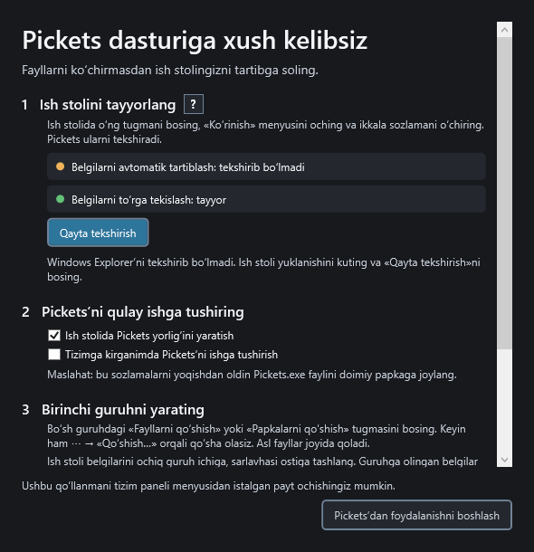
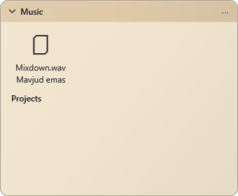

# Pickets — o‘zbekcha versiya

Windows 10/11 ish stolidagi fayl, papka va dastur yorliqlarini ko‘chiriladigan guruhlarga yig‘uvchi ochiq kodli dastur. Bu repozitoriy [Creeptones/Pickets](https://github.com/Creeptones/Pickets) dasturining **norasmiy o‘zbekcha (lotin yozuvi) tarjimasi**. Asl loyiha va ushbu tarjima MIT litsenziyasi asosida tarqatiladi; [LICENSE](LICENSE) faylini ko‘ring.



## Yuklab olish

[Releases](https://github.com/Kingprogrammer07/Pickets-UZ/releases) sahifasidan `Pickets-UZ-v1.0.2-uz.1-win-x64.zip` arxivini yuklab oling. Uni doimiy papkaga, masalan `C:\Programs\Pickets-UZ` ichiga chiqaring va `Pickets-UZ.exe` ni ishga tushiring. Bu ko‘chma versiya: o‘rnatgich va alohida .NET o‘rnatish talab qilinmaydi.

Windows SmartScreen noma’lum nashriyot haqida ogohlantirishi mumkin, chunki fayl raqamli imzolanmagan. Yuklab olingan faylning SHA-256 summasini release’dagi `SHA256SUMS.txt` bilan solishtiring:

```powershell
Get-FileHash .\Pickets-UZ-v1.0.2-uz.1-win-x64.zip -Algorithm SHA256
```

## Boshlash

1. Ish stolida o‘ng tugmani bosing va **Ko‘rinish (View)** menyusida **Belgilarni avtomatik tartiblash (Auto arrange icons)** hamda **Belgilarni to‘rga tekislash (Align icons to grid)** ni o‘chiring. Bu Windows’ning o‘z menyusi, nomi tizim tiliga bog‘liq.
2. Pickets’ning boshlash oynasida **Qayta tekshirish** ni bosing, so‘ng **Pickets’dan foydalanishni boshlash** ni tanlang.
3. Ish stolidagi belgini guruh ichiga sudrang. Asl fayl joyidan ko‘chmaydi; faqat ish stolidagi belgisi guruhda ko‘rsatiladi.
4. Guruh sarlavhasini bosing — yig‘iladi yoki ochiladi. Sarlavhani sudrang — guruh ko‘chadi. `⋯` menyusidan fayl va papka qo‘shishingiz mumkin.



**Belgilarni qaytarish:** tizim panelidagi Pickets belgisini o‘ng tugma bilan bosing va **Pickets’dan chiqish…** ni tanlang. Dastur ish stolidan olgan belgilar avvalgi joyiga qaytadi. `Alt+F4` esa dasturni faqat yashiradi.

Qo‘shimcha amallar va tugmalar uchun [o‘zbekcha qo‘llanma](docs/UZ_GUIDE.md) ni ko‘ring. [Asl inglizcha README](README.en.md) ham saqlangan.

## Koddan yig‘ish

.NET 10 SDK kerak. Windows’da repozitoriy ichida:

```powershell
dotnet test Pickets.Tests/Pickets.Tests.csproj -c Release
dotnet publish Pickets.csproj -c Release -r win-x64 --self-contained true -p:PublishSingleFile=true -p:IncludeNativeLibrariesForSelfExtract=true
```

Natija `bin/Release/net10.0-windows/win-x64/publish/Pickets.exe` ichida bo‘ladi.

## Kelib chiqishi

Asl dastur: [Creeptones/Pickets](https://github.com/Creeptones/Pickets), v1.0.2. O‘zbekcha matnlar, ularga mos testlar va qo‘llanma ushbu repozitoriyda qo‘shilgan. Mualliflik huquqi va MIT litsenziyasi saqlangan. Dastur Stardock bilan aloqador emas.
