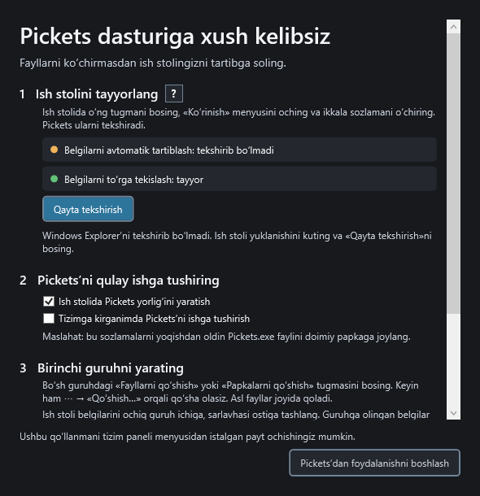
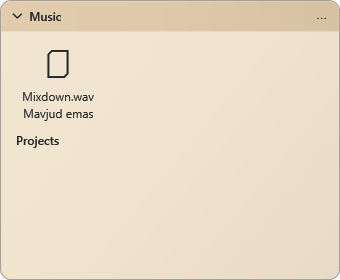
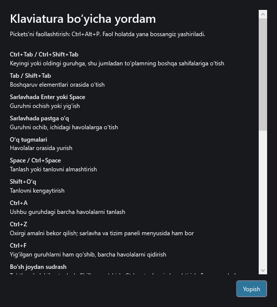

# Pickets: o‘zbekcha qo‘llanma



## Birinchi ishga tushirish

Ish stolida o‘ng tugmani bosing → **View / Ko‘rinish**. **Auto arrange icons / Belgilarni avtomatik tartiblash** va **Align icons to grid / Belgilarni to‘rga tekislash** belgilari o‘chirilgan bo‘lishi kerak. So‘ng Pickets oynasidagi **Qayta tekshirish** tugmasini bosing. Dastur bu sozlamalarni o‘zi o‘zgartirmaydi.

## Guruh yaratish va to‘ldirish

- Tizim panelidagi Pickets belgisini o‘ng tugma bilan bosing → **Yangi guruh**.
- Ish stolidagi belgi, papka yoki faylni ochiq guruh ichiga sudrang. Asl fayl ko‘chmaydi va o‘chmaydi.
- Guruhdagi `⋯` menyusi → **Qo‘shish…** orqali boshqa joydagi fayl yoki papkaga havola qo‘shing.
- Guruh nomini o‘zgartirish uchun sarlavhani tanlab `F2` ni bosing.
- Sarlavhani bosing — guruh yig‘iladi yoki ochiladi. Sarlavhani sudrang — guruh ko‘chadi.



## Topish va boshqarish

- `Ctrl+F` — barcha guruhlardagi havolalarni qidirish.
- `Ctrl+Z` — qo‘llab-quvvatlanadigan oxirgi amalni bekor qilish.
- `Ctrl+Alt+D` — guruhlarni faollashtirish yoki yashirish (standart tugmalar).
- `F1` — klaviatura yordam oynasi. 
- `Delete` — tanlangan havolani guruhdan olib tashlash; asl fayl o‘chirilmaydi.

## Ish stoli belgilarini qaytarish

Tizim panelidagi Pickets belgisini o‘ng tugma bilan bosing → **Pickets’dan chiqish…**. Guruhga olingan ish stoli belgilarining asl joyi tiklanadi. **Barcha belgilarni tiklab chiqish…** bandi esa keyingi ishga tushishda ularni qayta yashirmasdan chiqaradi.

Agar dastur ishga tushmasa, uning papkasida quyidagini bajaring:

```powershell
.\Pickets-UZ.exe --restore-icons
```

Bu buyruq guruhga olingan ish stoli belgilarini qaytarish uchun mo‘ljallangan. Batafsil texnik ma’lumot uchun [asl loyiha qo‘llanmasi](https://github.com/Creeptones/Pickets/blob/main/docs/USER_GUIDE.md) ni ko‘ring.
